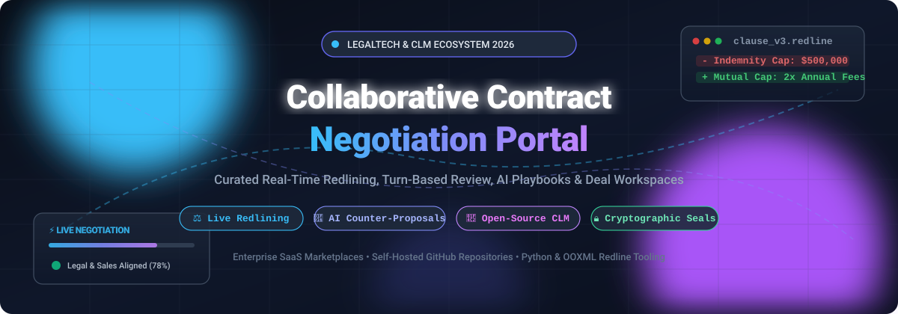

  

# 📑 Awesome Collaborative Contract Negotiation Portal

  
  
  
  
  
  
  

---

## 🧭 Curated LegalTech Ecosystem for Real-Time Redlining, Turn-Based Review & Deal Workspaces

> **A comprehensive, SEO-optimized directory of enterprise SaaS solutions and self-hosted open-source software powering modern contract negotiation, AI-assisted clause review, DOCX redlining diffs, and digital agreement governance.**  
> *Last updated: March 2026*

This repository indexes the state of the art in **Collaborative Contract Negotiation Portals** and **Contract Lifecycle Management (CLM)** tools. These platforms offer synchronized deal environments where in-house counsel, procurement leaders, and sales deal-desks negotiate counter-proposals together—delivering real-time redlining, automated playbook compliance checks, clause library insertion, and AI-powered counter-offer drafting.

Whether your team is procuring an enterprise-scale digital contracting hub (like Ironclad or Icertis) or seeking lean, self-hosted, vendor-neutral open-source tools (like draftLegal, docx-cli, or Documenso), this guide provides clear benchmarks on pricing, free tiers, company scale, and star-ranked developer tooling.

---

## 📑 Table of Contents
- [📊 Sector Overview & Market Dynamics](#-sector-overview--market-dynamics)
- [🏢 SaaS & Hosted Negotiation Platforms](#-saas--hosted-negotiation-platforms)
- [💻 Open-Source GitHub Projects & Tooling](#-open-source-github-projects--tooling)
- [💡 How to Choose a Contract Portal](#-how-to-choose-a-contract-portal)
- [🤝 How to Contribute](#-how-to-contribute)
- [💖 Support & Sponsorship](#-support--sponsorship)
- [📈 Star History](#-star-history)
- [⚖️ Disclaimer](#️-disclaimer)

---

## 📊 Sector Overview & Market Dynamics

The global **Contract Lifecycle Management (CLM)** and collaborative negotiation software market is valued between **$1.8 billion and $3.2 billion**, compounding aggressively at a **11.6% to 14.2% CAGR** toward an estimated $10B+ footprint over the coming decade.

The sector remains **moderately fragmented**—spanning over 150+ specialized vendors across AI contract review copilots, enterprise suite CLMs, and CPQ-adjacent deal rooms. Rather than resolving into a single winner-take-all monopoly, the market is defined by active consolidation: platform stalwarts consistently acquire niche generative AI and workflow point solutions to augment their core legal and procurement suites.

---

## 🏢 SaaS & Hosted Negotiation Platforms

| Product | Scale (Valuation / Revenue) | Description | Starting Pricing | Free Tier / Trial Limits |
|---------|-----------------------------|-------------|-------------------|--------------------------|
| **[Icertis Negotiation Workspace](https://www.icertis.com/)** | ~$5.0B Valuation / $350M+ ARR | 🌐 Enterprise CLM negotiation suite with AI-driven risk assessment, multi-party collaboration, custom templates, and automated approval workflows. | **$100,000/year** (Enterprise deployment benchmark; ~$100–$500/user/month via custom contract) | **No free trial**; live custom proof-of-concept/demo via enterprise sales only. |
| **[Ironclad](https://ironcladapp.com/)** | $3.2B Valuation / $200M+ ARR | 🚀 Digital contracting platform featuring collaborative DOCX redlining, approval workflows, and generative AI review assistants. | **$500/month** (Entry tier benchmark; mid-market deployments typically start ~$30,000/year) | **No free trial or self-serve plan**; evaluation conducted via scheduled sales demo. |
| **[Outlaw](https://www.getoutlaw.com/)** (by Filevine) | $3.0B Parent Valuation / $250M+ Parent ARR | 📝 Modern contract platform focusing on dynamic template drafting, real-time negotiation, and native mobile e-signatures. | **$50/user/month** (Core plan starting price) | **No free trial**; access and product evaluations provided through guided sales demo. |
| **[PandaDoc Workspace](https://www.pandadoc.com/)** | $1.0B Valuation / $100M+ ARR | ⚡ Collaborative document workflow suite with real-time deal rooms, inline commenting, approval rules, and e-signatures. | **$19/user/month** (Starter tier, billed annually; or $35/mo billed monthly) | **Free Forever eSign Plan**: 5 documents/month, 2 recipients/document, 5 templates; **14-day free trial** on paid plans (up to 50 documents, 5 recipients). |
| **[LinkSquares Finalize](https://www.linksquares.com/)** | ~$800M Valuation / ~$60M ARR | 🔍 Pre-signature contract workspace covering drafting, Word-native redlining, approval workflows, and deep Salesforce integration. | **$208/user/month** (Billed annually at ~$2,500/user/year; median contract value ~$31,000/year) | **No free trial**; prospective customer evaluations conducted via custom sales demonstration. |
| **[DealHub](https://dealhub.io/)** | ~$280M Valuation / $60M+ ARR | 🤝 Quote-to-revenue platform featuring digital DealRooms, CPQ, contract negotiation portals, clause libraries, and DealSign. | **$60/user/month** (Starting seat benchmark for core CPQ/CLM deployment tiers) | **No free trial**; prospective buyers evaluate through a tailored demo and sales consultation. |
| **[Agiloft Negotiation Portal](https://www.agiloft.com/)** | Majority KKR Private Equity / ~$70M Revenue | ⚙️ Highly configurable no-code CLM with Astra AI for clause extraction, automated risk flagging, and external party collaboration portals. | **$500/month** (Essentials base tier starting at $6,000/year; AI/Advanced tiers higher) | **Free Forever Tier (Astra)**: 1,000 AI credits/month, up to 3 custom playbooks/screens, unlimited users, and uncapped MS Word Add-In redlining. |
| **[ContractPodAi](https://contractpodai.com/)** (Leah) | Series C (SoftBank) / ~$50M Revenue | 🧠 AI legal copilot and negotiation platform offering risk scoring, playbook-guided redlining, clause extraction, and repository analytics. | **$4,166/month** (Standard mid-market starting tier benchmark at $50,000/year) | **No free trial**; guided proof-of-concept and customized product walkthrough via sales only. |
| **[SpotDraft](https://www.spotdraft.com/)** | Series B / ~$30M ARR | 🛡️ Modern CLM equipped with VerifAI for automated playbook-based redlining, turn tracking, and collaborative deal workspaces. | **$667/month** (Starting deployment benchmark from $8,000/year; median annual contract ~$25,278) | **No free trial**; live guided evaluation and sandbox walk-through available via sales. |
| **[Concord](https://www.concord.app/)** | Venture-backed / ~$12M Revenue | 🖋️ Cloud contract lifecycle management with live negotiation, collaborative editing, e-signature, and Salesforce two-way sync. | **$39/user/month** (Standard plan starting price, billed annually) | **14-day free trial**: Includes 5 test user seats, unlimited document uploads, unlimited eSignatures, redlining, and OCR search; unlimited free guests/viewers. |

---

## 💻 Open-Source GitHub Projects & Tooling

Curated open-source repositories and developer tooling for automated contract redlining, document-level tracked changes, self-hosted CLM, and digital agreement infrastructure—sorted in descending order by GitHub stars:

| Project | Star Badge | Description |
|---------|------------|-------------|
| **[Documenso](https://github.com/documenso/documenso)** |  | ✍️ The open-source DocuSign alternative. Self-hosted digital signature and agreement workflow infrastructure featuring cryptographic signing, webhooks, and modern developer APIs. |
| **[OpenSign](https://github.com/OpenSignLabs/OpenSign)** |  | 🔐 Free & open-source electronic signature platform with PDF templating, multi-party completion flows, custom signer fields, audit trails, and self-hosted Docker deployment. |
| **[claude-legal-skill](https://github.com/evolsb/claude-legal-skill)** |  | 🤖 AI-powered contract review skill with CUAD legal risk detection, playbook-driven market benchmarks, and lawyer-ready redline generation for Claude Code, Cursor, and Codex. |
| **[docx-cli](https://github.com/kklimuk/docx-cli)** |  | 📄 CLI utility allowing AI agents to edit Word documents reliably—enabling automated table updates, inline comments, and native Word redlining with tracked changes. |
| **[adeu](https://github.com/dealfluence/adeu)** |  | 🔄 DOCX-to-LLM bridge projecting Word agreements into clean Markdown for AI editing, then mapping edits back to OOXML as native Word tracked changes (redlines). Python & Node.js. |
| **[Python-Redlines](https://github.com/JSv4/Python-Redlines)** |  | 🐍 DOCX comparison engine that computes Word-level differences and outputs native Microsoft Word tracked changes (redlines) entirely in Python without Word runtime dependencies. |
| **[LegalWork](https://github.com/eigenweltlabs/legalwork)** |  | 💻 Local, privacy-first legal AI agent desktop environment for legal teams to review, redline, compare drafts, and generate counterproposals with local or cloud LLMs. |
| **[Docxodus](https://github.com/JSv4/Docxodus)** |  | 🛠️ Toolkit for Word agreements: high-fidelity DOCX-to-HTML rendering, browser-based block editing, Word-grade native tracked-change redlines, and markdown anchor addressing for agents. |
| **[doc-haus](https://github.com/sure-scale/doc-haus)** |  | 📂 Open-source legal AI assistant where contracts stay on local disk, delivering redlines, clause suggestions, and counter-proposals directly into Microsoft Word files as tracked changes. |
| **[legal-redline-tools](https://github.com/evolsb/legal-redline-tools)** |  | 📊 Python utility transforming structured AI contract reviews into tracked-changes Word documents (.docx) and visual redline comparison PDFs formatted for formal lawyer deliverables. |
| **[draftLegal](https://github.com/AniketTati/draft-legal)** |  | 🏛️ Self-hosted, AI-native CLM providing agent chat over contracts, multi-party redlining with conservative/aggressive counter-proposal modes, approval routing, and Docker Compose deployment. |
| **[openclm](https://github.com/bytecrunch-io/openclm)** |  | 👥 Collaborative open-source CLM featuring turn-based contract negotiation, word-level redline diffs with counterproposals, comments, accept/reject decisions, and SHA-256 sealed executed PDFs. |
| **[veqtor-mcp](https://github.com/JohnDeer-ai/veqtor-mcp)** |  | 🔌 Model Context Protocol (MCP) server for comparing Word contract drafts and generating tracked-change counterproposals with LLMs using atomic replace/delete/reinstate operations. |
| **[redline-buddy](https://github.com/dhruv1220/redline-buddy)** |  | 🎯 Deterministic contract review and redlining engine featuring 20+ playbooks (SaaS vendor, NDA, DPA, MSA), risk scoring with letter grades, and negotiation round deltas. |

---

## 💡 How to Choose a Contract Portal

When selecting between SaaS platforms and open-source infrastructure for collaborative negotiations:

1. **Security & Data Sovereignty**: If negotiating proprietary IP or highly regulated NDAs/DPAs, self-hosted open-source stacks (such as **draftLegal** or **doc-haus**) allow local inference with no third-party data retention.
2. **Turn-Based vs. Real-Time Redlining**: Modern enterprise deals frequently bounce between external Word tracked changes and live browser negotiation. Use tools like **adeu** or **Docxodus** to bridge Word OOXML files with browser interfaces.
3. **CRM & CPQ Integration**: Sales-driven contract portals (like **DealHub** or **Ironclad**) excel when integrated directly with Salesforce, HubSpot, or CPQ pipelines to minimize sales cycle latency.

---

## 🤝 How to Contribute

Contributions are warmly welcomed! To contribute:

1. Fork this repository 🍴
2. Create your feature branch (`git checkout -b feature/amazing-tool`)
3. Add the project under either **SaaS & Hosted Platforms** or **Open-Source GitHub Projects** following the established format
4. Ensure all links, descriptions, and metadata are accurate and objective
5. Commit your changes (`git commit -m 'Add AmazingTool to collaborative portals'`)
6. Push to the branch (`git push origin feature/amazing-tool`)
7. Open a Pull Request 🚀

---

## 💖 Support & Sponsorship

If you find this curated ecosystem directory helpful for your legal operations, engineering, or procurement stack, please consider supporting the project:

- ⭐ **Star this repository** to help others discover it!
- 🍴 **Fork and share** with colleagues and legal tech communities.
- ☕ **Sponsor / Buy a coffee**: Support ongoing maintenance and curated updates directly via the [GitHub Sponsors Dashboard](https://github.com/sponsors/ishandutta2007).

Thank you for being part of the open legal engineering community! 🌟

---

## 📈 Star History

---

## ⚖️ Disclaimer

- This is an **independent, community-curated list** — inclusion does not imply endorsement or official partnership.
- Contract negotiation portals handle legally sensitive agreements and counterparty communications; always enforce appropriate role-based access control, cryptographic verification, and compliance with GDPR, HIPAA, and relevant jurisdictions.
- Validate redline accuracy, tracked-change fidelity, and digital signature legality before relying on automated tools for legally binding agreements. AI-generated counter-proposals always require qualified legal review.

---

  <b>Built for Legal Operations Teams, General Counsels, Sales Engineers, and LegalTech Developers.</b> 
  Let's make contract negotiation collaborative, transparent, and auditable.

